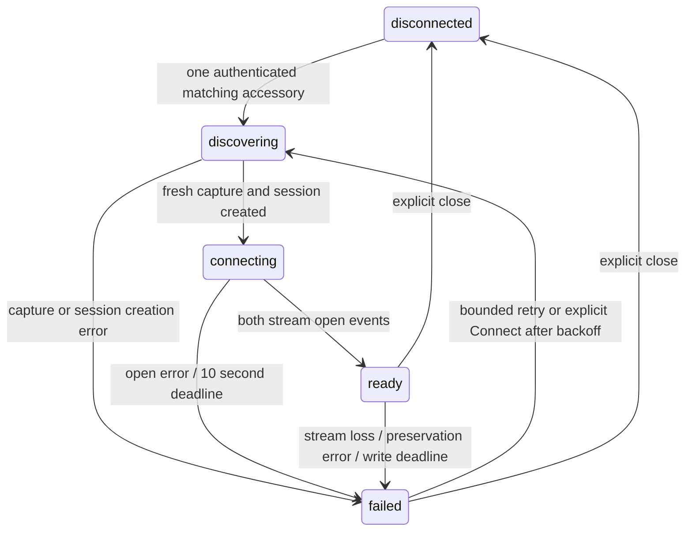

# Milestone 5 — MX+ transport shell

Status: PARTIALLY COMPLETE. Independent implementation and automated verification
passed. Signed delivery, Apple processing, phone installation and the first physical
MX+ identity round trip passed. The flicker fix passed native regression tests and
is uploaded as build 5.1; the user confirmed the flicker is gone. Physical
unplug/replug testing exposed a post-disconnect automatic-recovery bug, now under
verification; remaining lifecycle edge cases stay open.

## Ownership and lifecycle

`TransportExecutor` owns a dedicated native thread/run loop, with a 32-command
mailbox. `MXPlusExternalAccessoryTransport` owns accessory notifications,
EASession and both streams. `TransportPump` owns byte delivery, generation checks
and deadlines. Go `ConnectionCapture` owns command bytes and authoritative files.
SwiftUI sees `TransportDebugModel`, with no ExternalAccessory imports in views.
The physical build opens a dedicated adapter screen; Simulator always uses the
accepted mock dashboard. There is no fallback to synthetic readings on device.



On physical-screen startup, observers register and existing accessories are
enumerated. This opens only the byte session; no command is sent. Notifications cause
re-enumeration; zero/multiple matches are explicitly reported. Selection requires
`com.obdlink`; reported name/model/firmware are retained as evidence. Disconnect
removes observers, unregisters notifications, unschedules/closes streams and closes
the capture. Old stream objects and pump generations cannot feed replacement work.
While discovery is armed, notifications trigger immediate reconciliation and a
two-second directory check recovers missed/early notifications and stream failures.
Session-open attempts honor 2, 4, 8, then 16-second backoff and stop after three
unsuccessful opens for an unchanged candidate set. A real candidate-set change,
a successful streams-ready connection, or explicit Connect rearms the budget.
Unchanged notifications cannot bypass the retry cap. Idle checks only enumerate
accessories; they send no commands. Explicit Disconnect cancels observation and
periodic recovery, including late queued notifications.
Foreground/background events are logged while a connection exists. No automatic
drive creation, polling or engine-running inference is implemented.

## Bounds, writes and timing

Incoming reads are at most 4 KiB, with 16 reads per callback. Each synchronously
reaches Go/disk on the dedicated thread before another read; there is no retained
inbound application queue or AsyncThrowingStream. Kernel/accessory buffering is
outside this guarantee. Stream errors and preservation failures stop the pump.
Outbound storage is one Go-owned buffer, limited to 64 KiB; the actual permitted
command is four bytes. Partial acceptance is recorded, zero progress waits for a
space event, and a five-second continuous-clock write deadline ends uncertain writes.
The deadline is checked before every resumed write as well as by the timer,
so suspension cannot allow a stale queued command to be sent first. Buffers are
cleared at close and never replayed on reconnect. Maximum capture file: 64 MiB,
with 8 KiB reserved for explicit error/close records. No retention/deletion policy
has been added. Disk-full can prevent the final error record; UI reports that
failure and a missing close remains interrupted evidence.

Native `mach_continuous_time` converted with its timebase supplies monotonic
nanoseconds (including suspend duration); one Unix-ms anchor maps elapsed times.
These are application receipt/stream-acceptance times, not ECU measurement times.
The 32-row UI preview truncates byte previews to 256 bytes; disk logs retain exact
bytes. All counts shown are measured receive/request/stream-accepted counts.

## Capture format

`Documents/ConnectionCaptures/connection-<random 128-bit hex>.jsonl` is a separate
version-1 transport capture, not a schema-1 drive session. Rows contain:
`capture_version`, `connection_id`, contiguous `sequence`, `kind`,
`native_monotonic_ns`, `mapped_unix_ms`, optional `bytes_base64`, `detail` and
first-row `metadata`. Go []byte JSON uses Base64. Event kinds: opened,
streams_ready, write_requested, write_accepted, received, error, identity_timeout,
foreground, background, inactive, closed. Closed details retain unsent bytes;
stream acceptance never proves adapter delivery. Missing close is incomplete.
Mock drive exports and their legitimately empty raw files remain unchanged.
Python does not weaken its existing nonempty session-raw rejection.

Validate exported connection files with:

```sh
analytics/.venv/bin/python -m vehicle_flight_recorder validate-connection /path/capture.jsonl
# Opt-in inspection, without repairs:
analytics/.venv/bin/python -m vehicle_flight_recorder validate-connection /path/capture.jsonl --allow-incomplete
```

## Command references

Reviewed October 29, 2026: [OBDLink Family Reference and Programming Manual E](https://www.scantool.net/scantool/downloads/678/obdlink_frpm_e.pdf),
sections 6 and 8.4. STI prints adapter firmware identity. Exact permitted command:
ASCII `STI` plus CR (`53 54 49 0D`), once per capture, enabled separately by the
user. Connecting sends nothing. A bare CR repeats the previous command and is
never used as a probe. No reset/init/ECU command is exposed. The fixture response
`STI\rSTN2232 v5.10.3\r>` exercises split/coalesced delivery; it is synthetic,
not a promise of the installed adapter's firmware or echo settings. Receiving
bytes is not automatically a valid identity response; M5 preserves them for
review. No bytes within ten seconds records an identity timeout, without retry.
The manual's contents labels revision E January 10, 2025; its revision history
labels it March 28, 2025. The revision letter is the reproducible identifier.

Apple [EASession](https://developer.apple.com/documentation/externalaccessory/easession)
and [stream scheduling](https://developer.apple.com/documentation/externalaccessory/easession/outputstream)
define the native channel contract. Manufacturer MFi approval is already recorded
in the project plan. Bluetooth Classic/MFi remains the approved path.

## Verification and remaining acceptance

Go transcript tests cover exact STI, ordered chunks, partial acceptance, arbitrary
write rejection, stale/closed capture rejection, clock regression, oversized chunks,
file budgets and disk failure. Python tests cover identity/sequence/version/command/
encoding/clock validation and interrupted captures. Native tests cover fragmented/
coalesced reads, partial/zero/error writes, deadlines, stale generations, overflow,
idempotent close and actual Swift-to-Go capture files. Existing recorder/UI tests
remain required. An injected accessory directory exercises existing/later enumeration, unsupported
and multiple matches, failed session creation, notification delivery, repeated
connect/disconnect, observer cleanup and stale stream objects. Physical framework
behavior is now confirmed for the real identity round trip below. Other physical
cases remain separated from fixture/native test evidence.

Native CI results and artifact links are recorded below.
Signed workflow and installation instructions: [IOS_DEVICE.md](IOS_DEVICE.md).
As of October 30, 2026, Apple Developer enrollment is approved. The matching
distribution certificate/profile and App Store Connect API credentials are
configured in the GitHub `ios-device` environment with explicit user approval.
Workflow-only PR #4 is merged; the app remains unmerged in draft PR #3. Signed
archive/export and TestFlight upload passed. Apple reports the upload COMPLETE
and build VALID. The user installed build 4.1 and supplied real MX+ capture evidence
with a successful identity round trip; details and remaining gaps are below.

| Physical case | Status |
| --- | --- |
| Signed build installed; device/iOS/build/adapter recorded | Passed: user screenshots/capture, iPhone 16 Pro / iOS 26.6.2 / 0.1.0 (4.1) / MX201 |
| Accessory discovery and stream open | Startup-connected and launch-before-attachment passed per user report; multiple accessories not physically tested |
| Repeated open/close and actual identity round trip | Raw round trip and explicit reconnect passed; automatic recovery after physical unplug/replug failed in build 5.1, fix verification pending |
| Disconnect during write / reconnect without replay | No resend after reconnect per user report; physical mid-write interruption not tested |
| Foreground / background / locked / unlock | Scene transitions recorded; separate lock/unlock and app switching passed per user report |
| Suspended / OS terminated / user force quit | Not separately tested; no wake guarantee |

Do not intentionally disrupt ECUs. Use a parked setup and stop transmissions if
unexpected vehicle warnings occur. Retain local raw evidence, but do not publish
real accessory/vehicle identifiers in public CI artifacts. Native CI uploads only
synthetic connection fixtures. Appetize remains a mock regression tool.

Milestone 6 not started.


## Verified implementation — October 29, 2026

Implementation commit `ad7f4c7f7294b55ac5ebd4b9b24f0cd88ea52698` passed
[run 40924929254](https://github.com/KaleTEvans/VehicleFlightRecorder/actions/runs/40924929254).
Both source-built framework slices passed checks. Go was 1.26.10 darwin/arm64.
The accepted preview path used Xcode 16.4 / iOS 18.5 SDK; the separate device
Release archive used Xcode 26.0.1 (17A400) / iOS 26.0 SDK. Downloaded device plist
confirms the approved bundle/version, iPhoneOS platform, iOS 17 floor and compiled
AppIcon. The framework input hashes matched the local checkout. Neither archive
was signed or installed.

Eighteen hosted unit tests passed with zero failures (3.855 s), including seven
new transport tests (0.058 s). Both UI regression tests passed with zero failures
(141.974 s), retaining evidence scrolling and interrupted mock-session behavior.
Native-created healthy/manual and voltage/TCM ZIPs passed Python validation and
reconstruction in CI and again after download. These remain synthetic scenarios.
The native fixture capture independently passed local Python validation:

- File: `connection-3352e6060314f371695127d4300bec5d.jsonl`.
- Nine ordered rows; four requested bytes, four stream-accepted bytes, 21 received
  fixture bytes, zero unsent bytes; closed, transport-only, adapter delivery unproven.
- SHA256: `eb43e91db4678ce86833774e44fc931d1d7b299f0a0e5a1efaf3fd5c69c78517`.
- This is an exact native Swift/Go synthetic transcript, not a physical response.

Portable checks passed: all eight Go packages and vet, focused connection race
checks including concurrent receive/close (1.135 s), 70 Python tests, 22 script
tests, actionlint, shell syntax and diff/format checks. No measured vehicle
throughput, battery, background reliability or real engine/module behavior is
claimed. Browser automation/Appetize observation was not required to substitute
for the physical matrix; this run intentionally skipped Appetize upload.

Artifacts (14-day retention):
[native tests/exports/capture](https://github.com/KaleTEvans/VehicleFlightRecorder/actions/runs/40924929254/artifacts/12921220881),
[simulator ZIP](https://github.com/KaleTEvans/VehicleFlightRecorder/actions/runs/40924929254/artifacts/12919389929),
[device SDK compile provenance](https://github.com/KaleTEvans/VehicleFlightRecorder/actions/runs/40924929254/artifacts/12918679472).
Local copies are in ignored `build/milestone-5-native-evidence` and
`build/milestone-5-device-evidence`. The existing Appetize preview remains at
https://appetize.io/app/nrnzclustneju2ltjppkozdkta and continues to represent the
previous accepted mock build.

At the time of this October 29 run, the signed pipeline had not been executed
and Apple Developer enrollment was still pending. The October 30 delivery status
is recorded in the later delivery/physical sections; those checks were pending
at the time of the October 29 run.
The SDK split is a necessary delivery adjustment for Apple's April 2026 upload requirement; Go,
x/mobile, approved identity and deployment floor remain pinned. No M6 polling,
initialization, vehicle decoding or automatic drive policy was introduced.

Milestone 6 not started.

## Approved offline preparation extension — October 29, 2026

While awaiting Apple Developer enrollment approval, the user authorized bounded
preparation from M6 inside this milestone. `core/obd` now supplies prompt framing,
a fixed documented catalog (support block 00, coolant, RPM and STVR voltage),
11-bit single-frame response decoding and per-ECU capability states.
`core/acquisition` supplies explicit-clock serialized scheduling, bounded history,
priorities/fairness, backoff, partial-write deadlines, timeout draining, reconnect
generations and a standalone synthetic report. The offline CLI wires those to a
scripted adapter; Python independently validates raw references, decoded values,
capability advertisements, timing and derived rate/gap/latency populations.

Full contract, references, limits and reproduction:
[OFFLINE_ACQUISITION.md](OFFLINE_ACQUISITION.md). Healthy and timeout/reconnect
runs each cover 12 logical seconds with no real-time waiting. Healthy produces
37 transactions and 51 observations; edge cases produce 36 transactions and 46
observations across two generations. Timeout/late replies and cancellation remain
explicit. Both reports are byte-reproducible and passed independent Python checks.
A third partial-reply run retains 34 observations and 17 partial outcomes while
excluding malformed responder values. These are synthetic fixture outcomes, not
physical acquisition rates.

Portable verification passed: all Go packages/tests and vet, focused
OBD/acquisition race checks, 98 Python tests (28 acquisition tests), 22 script
tests, actionlint and diff/format checks. A bounded five-second framing/parser
final-source fuzz run completed 156,986 executions with two workers, zero failures. Resource
checks include bounded actual file reads during growth and stopping at the
transaction-history limit without silently discarding evidence.

The native dependency closure was checked: neither new package is imported by
`core/mobile`. No Swift, binding surface, native command allowlist, toolchain or
app behavior changed in this extension, so no new native build or Appetize upload
was needed. Prior native evidence remains tied to its recorded implementation
commit; it is not relabeled as testing these offline packages.

Physical acceptance is still pending. No adapter initialization, vehicle polling,
production live-drive schema migration, real capability/reference measurements,
automatic-drive policy or notification feature was enabled. The initial profile
and catalog are deliberately narrow; expanded definitions/formats and live
integration remain in the detailed M6 handoff. Offline M6 preparation is now
implemented within the approved M5 extension; **M6 live integration not started.**

## Signed delivery verification — October 30, 2026

Workflow-only [PR #4](https://github.com/KaleTEvans/VehicleFlightRecorder/pull/4)
is merged as `b1a036f4e3e8b8fcc70c34508452de652e86a3c8`. It enables manual
builds from the unmerged Milestone 5 source without merging the app implementation.
The initial dispatch used an abbreviated SHA and stopped at checkout; subsequent
dispatches use the full 40-character source SHA.

[Signing-only run 41093880633](https://github.com/KaleTEvans/VehicleFlightRecorder/actions/runs/41093880633)
passed against `81c8fbf4429c41bcb5294d265afae355466adbc3`: pinned framework/project
build, certificate/profile import, signed Release archive, IPA export, native
`codesign --verify --deep --strict`, artifact retention and signing cleanup.
Its TestFlight upload step was intentionally skipped.

The downloaded IPA also passed local ZIP integrity and metadata checks:

- App identity `com.kaleevans.vehicleflightrecorder`, version `0.1.0 (2.1)`.
- `MinimumOSVersion` 17.0; SDK `iphoneos26.0`.
- Embedded distribution profile and code resources present.
- IPA size 2,077,928 bytes; SHA-256
  `a53b37957da52d035005bca7842ccb8a442e2846c4853d9578a3b5dd8ee6ad2c`.

Local ZIP checks do not replace native signature verification; the runner supplied
that verification. Evidence is retained in ignored
`build/milestone-5-signing-evidence/signing-only`. The signed artifact has seven-day
GitHub retention. The successful TestFlight upload is recorded below. Apple
processing, installation and all physical accessory rows remain pending.

### Apple validation correction

[Upload attempt 41094417474](https://github.com/KaleTEvans/VehicleFlightRecorder/actions/runs/41094417474)
produced signed build `0.1.0 (3.1)` but **was not accepted by Apple**. Its altool log
reports validation error 409: missing upside-down orientation for iPad multitasking.
The upload tool returned zero, so the old workflow misleadingly reported success.
Do not treat that run's green status as delivery evidence.

Commit `9aa6e9a9b0d0e70e29be966af4d394a0247931a7` adds the iPad-specific four-orientation
array, retaining the existing iPhone orientations, and replaces the bare upload
command with `scripts/upload_testflight.sh`. The wrapper rejects a nonzero exit,
an explicit rejection, or output without an affirmative upload receipt. Its
transient log is removed on exit. All 29 script tests passed, including the
observed zero-exit rejection and upload receipt/error combinations; actionlint and
`git diff --check` passed.

The retry uses the corrected workflow from the M5 branch, not the old bootstrap
on master. Apple processing and installed-phone checks still require observation.

### Confirmed TestFlight upload

[Run 41095225007](https://github.com/KaleTEvans/VehicleFlightRecorder/actions/runs/41095225007)
passed the corrected upload guard and signing cleanup. Apple returned
`UPLOAD SUCCEEDED with no errors` and delivery UUID
`6640b095-9372-43d3-9c4a-392ec13d33a1`.

- Source: `9aa6e9a9b0d0e70e29be966af4d394a0247931a7`.
- Uploaded version: **0.1.0 (4.1)**, bundle `com.kaleevans.vehicleflightrecorder`.
- Downloaded IPA: 2,077,955 bytes; SHA-256
  `6e4d9a7ca1f5c1d69674b0a729662c3cf41801eb14ca2d0be160132a7392c5a5`.
- Local archive integrity, exact identity/build and four iPad orientations passed.
- Local evidence: ignored `build/milestone-5-signing-evidence/testflight`.

This confirms submission transport to Apple, not completed processing, an
invitation, installation, or any physical MX+ behavior. The account holder should
open the matching TestFlight build, complete account prompts, add themselves to
an internal test group and install on the phone using [IOS_DEVICE.md](IOS_DEVICE.md).
Milestone 5 stays partially complete until its physical acceptance matrix passes.

## First physical MX+ acceptance — October 30, 2026

The user supplied two phone screenshots and a closed JSONL capture from an iPhone
16 Pro, iOS 26.6.2 (23G90), installed TestFlight build 0.1.0 (4.1). The screenshots
show `Transport: ready` and zero outbound counters before the firmware read. The
later exported capture contains the explicit read and clean disconnect.

Independent Python `validate-connection` passed: 32 contiguous records, four
requested bytes, four stream-accepted bytes, 21 received bytes, zero unsent bytes,
closed state, no error or identity-timeout records. The exact exchange was:

```text
Requested: STI\r
Received:  STI\rSTN2255 v5.8.1\r\r>
```

The response demonstrates the controlled adapter identity round trip; it does not
verify ECU communication. The generic validator still labels adapter delivery
`unproven`, since stream acceptance alone is insufficient; the preserved reply
provides the additional identity evidence in this particular capture.

Both streams opened in 18.027 ms. First received bytes arrived 69.329 ms after the
request record (62.357 ms after stream acceptance); these are native host timing
observations for one identity command, not vehicle throughput or ECU timing.
Capture duration: 95.720 seconds, including five background and seven foreground
events. The raw data alone does not identify which transitions were phone locks,
app switching or other OS presentation. The user separately confirmed two
successful disconnect/reconnect repetitions and lock/unlock testing with no
errors or automatic identity resend. This is human evidence, not additional
exported captures or proof of execution while suspended.

Accessory metadata reports OBDLink MX+, manufacturer OBD Solutions LLC, model
MX201, hardware 1.0.0 and firmware 2.0.0. The STI response reports STN2255 v5.8.1;
retain both identity sources as observed rather than substituting one for the
other. The public report omits the native accessory ID and original capture ID.
Raw evidence and screenshots stay in ignored `.cache/physical-tests/2026-10-30`;
original JSONL SHA-256:
`71011a6b417f5ddb1d49e738553e61e67b121259ef4dfc5177df8298884c87dd`.
They must not be uploaded as public synthetic CI artifacts.

The user observed button flicker. The half-second snapshot refresh used the same
`busy` flag as explicit commands, briefly disabling the blue controls. Snapshot
reads now leave that flag alone; commands still gate controls, and a pending
snapshot cannot clear a command's flag. Two native regressions check busy-state
publications across repeated refreshes and an explicit disconnect.
[Native run 41128764873](https://github.com/KaleTEvans/VehicleFlightRecorder/actions/runs/41128764873)
passed for source `c847638b82da40ac34a7912846457e281a85c4e0`: 20 hosted tests
(including both new regressions) and two UI tests, zero failures. Native exports
passed Python validation/reconstruction, and both Xcode 16.4 unsigned device
compile and Xcode 26.0.1 Release archive passed. The signed corrected build is recorded below; its visual acceptance on the
physical phone remains pending.

Later accessory attachment subsequently passed per user report. Remaining
physical gaps are automatic recovery after an established session is unplugged,
multiple-accessory ambiguity, interruption during a partially accepted command,
and separately identified suspension/OS-termination/user-force-quit behavior. No universal wake
or continuity guarantee is claimed. M5 is not closed by the single supplied log.

**Milestone 6 not started.**

### Flicker-fix delivery — October 30, 2026

[Signed run 41129982462](https://github.com/KaleTEvans/VehicleFlightRecorder/actions/runs/41129982462)
passed for `c847638b82da40ac34a7912846457e281a85c4e0`, version **0.1.0 (5.1)**.
Apple returned `UPLOAD SUCCEEDED with no errors`, delivery UUID
`13a45210-570a-4042-a592-bfa23e2a4ec7`; runner cleanup passed. Local IPA integrity
and identity/build checks passed: 2,078,579 bytes, SHA-256
`1b8a9ddb27704b6327640db3f1a6aa5c7acf2e392aa0e978f7aae013a3d2c9db`.
Evidence is in ignored `build/milestone-5-signing-evidence/flicker-fix`.

Read-only Apple API status at 21:20:48 UTC: upload PROCESSING, no errors or warnings.
The processed build/testing resources were not available yet. This does not
invalidate the upload, and is not phone acceptance. After processing, install
build 5.1 and confirm the blue controls no longer pulse during idle refreshes.
The source retains the current encryption metadata; Apple may request the same
app-encryption questionnaire for this build before internal testing is available.
No compliance declaration or tester configuration was changed through the API.

**Milestone 6 not started.**

## Physical replug recovery correction — October 30, 2026

After the build 5.1 delivery, the user confirmed the blue-button flicker is gone.
They also reported these separate lifecycle observations:

- Unplugging MX+ while the app is open changes the displayed connection state
  after approximately five seconds (human observation, not an exported timing).
- Plugging it back in and reconnecting through iOS Bluetooth does not restore the
  existing app session automatically. Restarting the app does restore it. The
  user subsequently confirmed Discover / Connect also restores it without a
  restart, narrowing the failure to automatic recovery scheduling.
- Starting the app while MX+ is unplugged, then plugging/pairing it, does connect
  automatically. This later-attachment path passed.

The earlier successful reconnect report covered a different recovery path; it
must not be treated as evidence that physical replug recovery works.

Code inspection found that a notification received during backoff simply returns;
when backoff expires, nothing re-runs discovery. A stream failure after the last
notification can leave the same gap. Apple's
[connection notification documentation](https://developer.apple.com/documentation/foundation/nsnotification/name-swift.struct/eaaccessorydidconnect)
also documents notifications before authentication completes, with empty protocol
strings. These are reproducible software failure paths, not proof of the precise
notification order on the user's phone.

The owner-thread timer now reconciles the directory every two seconds while
armed. It closes a session if its required protocol disappears, checks protocol
readiness again, and honors pump backoff before creating a new capture/session.
No files or sessions are created for absent/unsupported/ambiguous candidates.
At most three unsuccessful open attempts are allowed for an unchanged candidate
set; duplicate notifications do not replenish them. A new candidate set, a
successful ready connection or an explicit Discover / Connect rearms the budget.
Failure before stream creation now starts a fresh attempt state so each failure
advances backoff rather than reusing an old failed state indefinitely.

Each recovered session gets a fresh capture/generation; old stream callbacks and
pending identity bytes are discarded. Explicit Disconnect disarms all recovery.
The view model separately retains explicit action errors and current pump errors,
allowing successful recovery to clear an obsolete transport error without polling
hiding a failed user action. The existing no-flicker command gating remains.

New native regressions exercise a replug notification inside backoff with no
second notification, stale callbacks and zero replay, explicit Disconnect with a
late callback, permanent session-open failure/backoff/three-attempt exhaustion,
manual retry, and empty/restored protocol lists without notifications. A view-model
regression checks error persistence until a successful action clears it. The app
metadata now carries the user’s existing non-exempt-encryption answer (`NO`) so
unchanged future builds do not require the repeated questionnaire. No new data
encryption or command types were introduced.

[Native run 41135972554](https://github.com/KaleTEvans/VehicleFlightRecorder/actions/runs/41135972554)
passed for `6d0e1da818b3b5c0db867f691e3373eb91d49693`: **24 hosted tests and two
UI tests**, zero failures. All three new transport regressions and the new
action-error regression passed, along with the prior flicker tests. Both device
compile profiles, native export validation and reconstruction passed. Corrected
signed delivery is recorded below; physical unplug/replug confirmation is pending.

**Milestone 6 not started.**

### Recovery-build delivery — October 30, 2026

[Signed run 41137176123](https://github.com/KaleTEvans/VehicleFlightRecorder/actions/runs/41137176123)
passed for `6d0e1da818b3b5c0db867f691e3373eb91d49693`, version **0.1.0 (6.1)**.
Apple returned `UPLOAD SUCCEEDED with no errors`, delivery UUID
`43d90f52-3720-4ae7-a022-bf47da0d0e52`, at **17:20:58 America/Chicago (CDT)**.
Signing cleanup passed. The downloaded IPA passed archive integrity, exact
bundle/build and `ITSAppUsesNonExemptEncryption = false` checks: 2,082,498 bytes,
SHA-256 `74e6bc064f10e9bee36bea114368bdfcb68e889e777203b055c88debdcaaa3cd`.
Evidence is in ignored `build/milestone-5-signing-evidence/replug-fix`.

At 17:23 CDT, read-only Apple API inspection reported upload/build/testing
PROCESSING, no upload errors/warnings, and `usesNonExemptEncryption: false`.
Processing is separate from transport submission. No declaration or tester-group
mutation was performed through the API. Physical acceptance of automatic replug
recovery remains open after build 6.1 becomes available.

Retest while parked: establish `ready`, unplug MX+, plug it back in and reconnect
through iOS Bluetooth, leaving the app running. Watch for up to 30 seconds and
record state/timing without pressing Discover / Connect or restarting. Expect a
new capture/generation with zero requested/accepted bytes until an explicit
identity read. Also check explicit Disconnect remains intentional: no reconnection
until Discover / Connect is pressed. If recovery still fails, preserve the exact
status/notice/error and closed captures; the three-attempt paused notice is an
explicit failure outcome, not a passed automatic-recovery test.

**Milestone 6 not started.**
