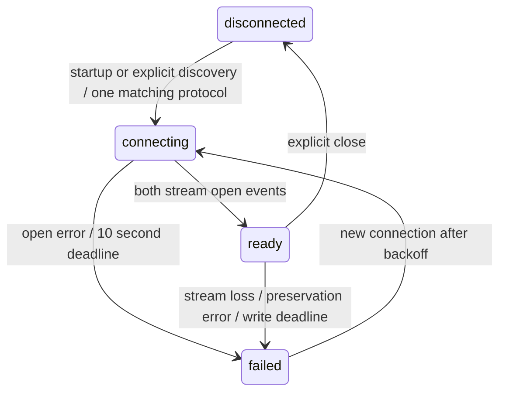

# Milestone 5 — MX+ transport shell

Status: PARTIALLY COMPLETE. Implementation/native verification is in progress;
no signing, installation or physical accessory acceptance has been observed.

## Ownership and lifecycle

`TransportExecutor` owns a dedicated native thread/run loop, with a 32-command
mailbox. `MXPlusExternalAccessoryTransport` owns accessory notifications,
EASession and both streams. `TransportPump` owns byte delivery, generation checks
and deadlines. Go `ConnectionCapture` owns command bytes and authoritative files.
SwiftUI sees `TransportDebugModel`, with no ExternalAccessory imports in views.
The physical build opens a dedicated adapter screen; Simulator always uses the
accepted mock dashboard. There is no fallback to synthetic readings on device.



On physical-screen startup, observers register and existing accessories are
enumerated. This opens only the byte session; no command is sent. Notifications cause
re-enumeration; zero/multiple matches are explicitly reported. Selection requires
`com.obdlink`; reported name/model/firmware are retained as evidence. Disconnect
removes observers, unregisters notifications, unschedules/closes streams and closes
the capture. Old stream objects and pump generations cannot feed replacement work.
Reconnect attempts occur only on a notification or explicit Connect action, with
2–16 second exponential backoff (30-second cap); no timer-driven reconnect storm.
Foreground/background events are logged while a connection exists. No automatic
drive creation, polling or engine-running inference is implemented.

## Bounds, writes and timing

Incoming reads are at most 4 KiB, with 16 reads per callback. Each synchronously
reaches Go/disk on the dedicated thread before another read; there is no retained
inbound application queue or AsyncThrowingStream. Kernel/accessory buffering is
outside this guarantee. Stream errors and preservation failures stop the pump.
Outbound storage is one Go-owned buffer, limited to 64 KiB; the actual permitted
command is four bytes. Partial acceptance is recorded, zero progress waits for a
space event, and a five-second write deadline ends uncertain writes. Buffers are
cleared at close and never replayed on reconnect. Maximum capture file: 64 MiB,
with 8 KiB reserved for explicit error/close records. No retention/deletion policy
has been added. Disk-full can prevent the final error record; UI reports that
failure and a missing close remains interrupted evidence.

Native `mach_continuous_time` converted with its timebase supplies monotonic
nanoseconds (including suspend duration); one Unix-ms anchor maps elapsed times.
These are application receipt/stream-acceptance times, not ECU measurement times.
The 32-row UI preview truncates byte previews to 256 bytes; disk logs retain exact
bytes. All counts shown are measured receive/request/stream-accepted counts.

## Capture format

`Documents/ConnectionCaptures/connection-<random 128-bit hex>.jsonl` is a separate
version-1 transport capture, not a schema-1 drive session. Rows contain:
`capture_version`, `connection_id`, contiguous `sequence`, `kind`,
`native_monotonic_ns`, `mapped_unix_ms`, optional `bytes_base64`, `detail` and
first-row `metadata`. Go []byte JSON uses Base64. Event kinds: opened,
streams_ready, write_requested, write_accepted, received, error, identity_timeout,
foreground, background, inactive, closed. Closed details retain unsent bytes;
stream acceptance never proves adapter delivery. Missing close is incomplete.
Mock drive exports and their legitimately empty raw files remain unchanged.
Python does not weaken its existing nonempty session-raw rejection.

Validate exported connection files with:

```sh
analytics/.venv/bin/python -m vehicle_flight_recorder validate-connection /path/capture.jsonl
# Opt-in inspection, without repairs:
analytics/.venv/bin/python -m vehicle_flight_recorder validate-connection /path/capture.jsonl --allow-incomplete
```

## Command references

Reviewed October 29, 2026: [OBDLink Family Reference and Programming Manual E](https://www.scantool.net/scantool/downloads/678/obdlink_frpm_e.pdf),
sections 6 and 8.4. STI prints adapter firmware identity. Exact permitted command:
ASCII `STI` plus CR (`53 54 49 0D`), once per capture, enabled separately by the
user. Connecting sends nothing. A bare CR repeats the previous command and is
never used as a probe. No reset/init/ECU command is exposed. The fixture response
`STI\rSTN2232 v5.10.3\r>` exercises split/coalesced delivery; it is synthetic,
not a promise of the installed adapter's firmware or echo settings. Receiving
bytes is not automatically a valid identity response; M5 preserves them for
review. No bytes within ten seconds records an identity timeout, without retry.
The manual's contents labels revision E January 10, 2025; its revision history
labels it March 28, 2025. The revision letter is the reproducible identifier.

Apple [EASession](https://developer.apple.com/documentation/externalaccessory/easession)
and [stream scheduling](https://developer.apple.com/documentation/externalaccessory/easession/outputstream)
define the native channel contract. Manufacturer MFi approval is already recorded
in the project plan. Bluetooth Classic/MFi remains the approved path.

## Verification and remaining acceptance

Go transcript tests cover exact STI, ordered chunks, partial acceptance, arbitrary
write rejection, stale/closed capture rejection, clock regression, oversized chunks,
file budgets and disk failure. Python tests cover identity/sequence/version/command/
encoding/clock validation and interrupted captures. Native tests cover fragmented/
coalesced reads, partial/zero/error writes, deadlines, stale generations, overflow,
idempotent close and actual Swift-to-Go capture files. Existing recorder/UI tests
remain required. An injected accessory directory exercises existing/later enumeration, unsupported
and multiple matches, failed session creation, notification delivery, repeated
connect/disconnect, observer cleanup and stale stream objects. Physical framework
behavior and every real lifecycle state remain pending acceptance.

Native CI results and artifact links will be recorded after the source build.
Signed workflow and installation instructions: [IOS_DEVICE.md](IOS_DEVICE.md).
Only Appetize secrets currently exist. On October 29, 2026 the user confirmed
that there is no Apple Developer membership yet. TestFlight enrollment,
signing/account setup and physical tests
remain pending; no unsigned compile proves a signed installation.

| Physical case | Status |
| --- | --- |
| Signed build installed; device/iOS/build/adapter recorded | Pending |
| Already connected / later connect / multiple accessories | Pending |
| Repeated open/close and actual identity round trip | Pending |
| Disconnect during write / reconnect without replay | Pending |
| Foreground / background / locked / unlock | Each pending |
| Suspended / OS terminated / user force quit | Each pending; no wake guarantee |

Do not intentionally disrupt ECUs. Use a parked setup and stop transmissions if
unexpected vehicle warnings occur. Retain local raw evidence, but do not publish
real accessory/vehicle identifiers in public CI artifacts. Native CI uploads only
synthetic connection fixtures. Appetize remains a mock regression tool.

Milestone 6 not started.
