# Milestone 7 — hands-off recording and controlled-road qualification

Status: PARTIALLY COMPLETE — implementation/native validation passed; signed 14.1
prepared, Apple upload awaiting user approval, November 18, 2026.
M6 is accepted/merged as `f793674`; its physical results remain the baseline.
No M7 physical, road, wake or battery acceptance is claimed. Milestone 8 has not
started. The existing edit in `docs/OFFLINE_ACQUISITION.md` is unrelated and retained.

## Workload and activity policy

The initial configuration preserves M6's validated CAN29/500 standard commands:
RPM every requested 2 s, coolant and adapter voltage 5 s, supported-PID block 00
60 s; one request in flight, 500 ms subsequent admission, 2 s timeout and bounded
backoff. Individual CAN IDs remain opaque. No enhanced requests, TCM identity,
vehicle identification, GPS or new automatic fault thresholds are introduced.

`rpm-activity-1` is a proposed test configuration, not a universal vehicle rule:
validated aggregate RPM >=400, repeated distinct responses spanning >=4 s, age
<=10 s; fresh all-zero response evidence for >=60 s ends a drive; unknown activity
or disconnected coverage gets 180 s grace. A native owner execution gap longer
than grace ends the previous logical drive. Missing modules do not suppress a
start supported by another responder; any positive running responder wins over
zeros in the same response. Low nonzero RPM below threshold is unknown.

M6 observed idle RPM around 917–982 with roughly 2.74 s Combined cadence. These
facts motivate the proposed margins but do not physically validate the policy.
Stationary running can start a drive; motion is not required. A ready scanner,
module replies, voltage or ignition-on/engine-off alone never starts one.

Activity probing is a separate retained `Automation/Probes/live-*` capture using
RPM-only requests. It is excluded from `Sessions` and from drive history. A
successful debounce closes the probe and creates a new automatic drive at its
own wall/continuous-clock anchor. An event references the separate pre-start
context; no earlier samples are inserted into the drive. Fresh setup/support
repeat on the recording connection. Initial setup delay is honest lost drive
coverage, with retained probe context; it is not silently backfilled.

Automatic drives are initially capped at **30 minutes**, probes at **5 minutes**
per capture. Probes rotate without deleting their originals. These caps permit
parked/short qualification; representative longer drives require a separately
measured and reviewed duration/resource configuration before release.

Manual Stop saves the drive and persists an override. Monitoring continues while
armed, but running evidence cannot immediately restart a drive. Sustained zero
RPM or explicit disable/re-enable rearms it. Disabling monitoring stops all
activity acquisition. Deliberate M6 stationary controls remain available while
monitoring is disabled. App-start callbacks, native events and manual actions
share one transport executor and a locked Go owner; drive ID and connection
generation are independent.

## Durable facts, notifications and relaunch

A successful automatic-start fact is emitted only after initialization and actual
telemetry admission. An adapter connection, empty directory, manual start or
startup failure cannot produce it. Coverage is explicitly limited standard OBD;
vehicle display identity falls back to `Vehicle` rather than inventing a name.
Go syncs evidence and durably claims a fact before handing it to native code.
Native exclusively claims selection before any presentation/API side effect.

Confirmation preference is persisted and optional. Permission is requested only
from the parked setup button, once when not determined. Denied users get a route
to system settings. Foreground uses an in-app banner; authorized background uses
a quiet local notification, no sound or badge. A scene change during submission
uses the delegate to suppress a duplicate system presentation. Per-session
receipt identities survive relaunch; submission errors/uncertainty are not retried.
A missed confirmation after a claim/crash is explicitly preferable to duplicates.
Disabled, denied, stale or ended facts are consumed without a later backlog.
Notification failure does not stop recording. Submitted does not mean seen.

The notification delegate is retained by the application delegate and installed
at launch. Taps carry the original ID and route to the active drive or saved
summary; missing/corrupt evidence is visible. A tap is never a start command.
The application owns transport independently of view refresh/navigation.

On relaunch, the Go journal records the previously active drive as interrupted,
leaves its original files untouched and requires fresh evidence for a distinct
new drive. It never adopts interrupted files as continuous recording, silently
trims rows or finalizes an interrupted session as healthy. Existing strict readers
still reject corrupt/truncated final rows; well-formed incomplete evidence requires
explicit incomplete inspection. Raw original retrieval remains available through
Files when evidence cannot be normally exported.

## Evidence and resources

Schema 2 is extended with an explicit optional policy version and automatic/probe
start origins in both metadata and capability configuration. Legacy manual/mock
contracts remain readable. Older readers reject the new policy; use the updated
reader. It verifies origin/version/workload/duration agreement, raw provenance
and the existing full CAN11/CAN29 setup/schedule contract.

Drive ZIPs preserve the existing six-file layout. Policy/lifecycle/confirmation
facts are canonical events when a drive is active. The separate Automation journal
retains pre-start transitions, resource samples and notification outcomes outside
a drive. Resource observations include retained byte size and Go heap population;
native execution samples battery level/charging state, thermal state and Low Power
Mode. These are observations while the app executes, not proof of continuous
measurement during suspension. Environmental temperature and start/end measurement
context require a human test record where not available to iOS.

Evidence retention is bounded at 512 MiB and 20,000 inspected entries, with no
silent deletion. Journal cap is 16 MiB; report/log/ZIP caps remain unchanged.
I/O/resource failures expose a failed state, stop acquisition and preserve original
incomplete evidence. Battery/storage acceptance budgets remain unmeasured.

## Platform references — checked November 18, 2026

- [Apple External Accessory](https://developer.apple.com/documentation/externalaccessory/)
- [Background execution modes](https://developer.apple.com/documentation/xcode/configuring-background-execution-modes)
- [Background execution sequence](https://developer.apple.com/documentation/uikit/about-the-background-execution-sequence)
- [Notification authorization](https://developer.apple.com/documentation/usernotifications/asking-permission-to-use-notifications)
- [Notification delegate](https://developer.apple.com/documentation/usernotifications/unusernotificationcenterdelegate)

Only the existing external-accessory mode is used. Declarations, timers,
notification permission and simulated callbacks do not establish launch/wake or
physical continuity. Foreground, locked, background, suspended, OS-terminated and
force-quit remain distinct unqualified physical cases until measured.

## Verification and remaining gates

Go policy and owner integration tests pass locally, including zero RPM, repeated
running activity, same-drive reconnect, manual override, exclusive ownership,
notification claim deduplication, preserved relaunch identity and storage failure.
Nine independent Python tests replay actual Go automatic/probe exports, reconstruct
manual incidents, and reject policy/duration relabeling. These are scripted
fixtures, not physical vehicle evidence.

Portable/native regression and signed artifact preparation have passed, and the
complete parked packet is prepared but not released pending approved upload and
TestFlight processing. First road use remains gated on analysis of the
parked results and a permitted workload. Repeated/long drives, quality/reference
comparison, lifecycle matrix and representative battery/storage budgets remain
acceptance gates. No car visit is requested before the tested beta and complete
packet are ready.

**Milestone 8 not started.**

## Logging inventory and state flow

| Population | Retained content |
| --- | --- |
| Engine RPM | Standard mode 01 PID 0C, rpm, each responding CAN ID, decoder/transaction/generation, receipt timestamp/quality |
| Coolant | Standard mode 01 PID 05, degC, same independent responder/raw provenance |
| Adapter supply | STVR input volts, source adapter; not an ECU battery sensor or alternator diagnosis |
| Availability | Block-00 supported-PID replies; advertised/observed/unsupported/unavailable/unknown, setup/profile/decoder versions |
| Raw transport | Exact requested, stream-accepted, received/late/unsolicited bytes, ordered references and monotonic deadlines |
| Policy | Config/version, candidate/start/end/grace/override decisions, evidence response identity, retained pre-start context |
| Incidents | Manual mark, 60/120 s evidence window, full/partial state and actual gaps/reasons |
| Lifecycle | Observed native phases, transport generations/recovery and unknown scheduling gaps; interruption/relaunch owner boundary |
| Confirmation | Durable successful-start and claim facts; selected path, suppression/submission/failure; original-session tap routing |
| Resources | Retained byte growth, Go heap population, native mailbox/outbound size, sampled battery/charging/Low Power/thermal context |
| Quality | Requested versus achieved per-responder rates, actual latency/error populations, whole/outside-explicit-gap denominators, receipt-age stale/initial-absence time |

Receipt-age freshness uses the existing UI's 15 s age budget; activity eligibility
uses its separate 10 s window. The reader labels these conventions explicitly and
does not infer ECU internal measurement time or sensor refresh. Per-hour battery
output is unavailable for charging/unknown populations; observed execution-only
samples do not qualify continuous background drain.

```mermaid
stateDiagram-v2
    [*] --> Disabled
    Disabled --> Monitoring: Explicit opt-in / persisted enabled restore
    Monitoring --> Candidate: Fresh validated running RPM
    Candidate --> Monitoring: Stale, zero or insufficient evidence
    Candidate --> Initializing: Distinct replies span debounce
    Initializing --> Recording: Setup and actual telemetry accepted
    Recording --> EndGrace: Fresh zero RPM
    EndGrace --> Recording: Running resumes
    EndGrace --> Finalized: Sustained zero evidence
    Recording --> Gap: Transport or activity unavailable
    Gap --> Recording: Fresh generation / activity restored within grace
    Gap --> Finalized: Unknown/execution grace expires
    Recording --> Override: Manual Stop or duration cap
    Override --> Monitoring: Sustained off or explicit rearm
    Finalized --> Monitoring: Retain closed drive; new probe
    Recording --> Interrupted: Observed on later relaunch
    Interrupted --> Monitoring: Originals preserved; fresh evidence / new ID
    Monitoring --> Failed: Storage/resource error
    Recording --> Failed: Storage/resource error
```

## Automated evidence so far

Initial source `d3b116add830e667ff111885c2d8a39426557f87` passed
[native run 44394000438](https://github.com/KaleTEvans/VehicleFlightRecorder/actions/runs/44394000438):
41 hosted tests, eight UI tests, both device compile profiles and independent
validation of 22 actual native ZIPs with all available incidents reconstructed.
This is a regression baseline, not acceptance of later changes or physical wake.

The portable full suite after bundle/routing changes passed 178 Python tests,
29 script tests, Go tests/vet. Broad race checks passed activity, mobile,
acquisition, recorder and storage; focused owner/policy race checks passed after
review fixes. Workflow lint and documentation links pass. Later reader changes
add whole-bundle claim/resource and freshness validation and will be rechecked
against final native artifacts. No private phone captures are public fixtures.

The final source has additional manual-after-disabled-setup regression, whole
native automation-bundle replay, bounded archive handling, canonical success-fact
time and distinct interruption/context identities. Its final native run passed as
recorded below. Superseded intermediate runs were cancelled
rather than treating their results as evidence for the final source.

**Milestone 8 not started.**

## Final native evidence and prepared signed beta — November 18, 2026

Exact app source: `4d6e857b2cc6c8457c73892597d529e0e1becd9e`.
[Native run 44397968453](https://github.com/KaleTEvans/VehicleFlightRecorder/actions/runs/44397968453)
passed **43 hosted tests, eight UI tests, both SDK compile profiles, 22 native
session ZIP validations and three whole diagnostic-bundle validations**.
All available incidents reconstructed. The downloaded artifact was independently
replayed with the final reader and its automatic-history screenshot reviewed.
The reader-only follow-up preserves the exact `core`/`ios` tree, passes **182 Python
tests**, and adds independently derived receipt-age/gap populations. Go tests/vet,
broad and focused race checks passed. Workflow lint passes; **34 script tests**
include retained-payload hash/provenance/application mismatch rejection.

Native artifact `14471873288` SHA-256:
`2e9c3a91c4efabfc533cc88dfa8a957f2d3022eff738fbb2bdeb0bfb55979db1`.
Retained privately under `build/milestone-7/native-4d6e857/`; its origin is
explicitly native-fixture, not physical telemetry.

[Signing-only run 44400084011](https://github.com/KaleTEvans/VehicleFlightRecorder/actions/runs/44400084011)
prepared **0.1.0 (14.1)** from that exact source. Archive/export, native signature
verification and signing-input cleanup passed. **The Apple upload step was
skipped. Build 14.1 is not yet in TestFlight.**

Signed artifact: `14471274404`, archive SHA-256
`071d19d9b3deecae60b4944465b31bdd6313941cd6e5c3b90187c1705b732fa8`.
The retained IPA is `build/milestone-7/signed-14.1/ios-device/export/VehicleFlightRecorder.ipa`.
Its independently verified SHA-256 is
`4704885038f15058e8212da61838348a4f373546cad8d2fb3ccc1960b1df4fe7`;
bundle `com.kaleevans.vehicleflightrecorder`, version `0.1.0`, build `14.1`, and
provenance match. A local prepared-upload manifest records these exact identities.

Automatic approval review rejected sending this new IPA to Apple because prior
approval covered an earlier build, not this exact M7 payload/destination action.
The upload remains blocked pending explicit approval. The existing signed workflow
now supports verification/upload of the retained IPA without rebuilding; it checks
its approved checksum, source, bundle/version and build before any upload. Its
default is verification-only. The approved Apple API/authentication path is unchanged.
No alternate upload has been attempted. No M7 car visit is requested until upload,
processing and the released packet are confirmed.

The [parked packet](../planning/milestone_7_test_session.md),
[reliability matrix](MILESTONE_7_RELIABILITY.md), and
[confirmation contract](RECORDING_CONFIRMATIONS.md) retain all actual physical,
road, reference and representative resource gates. PR #6 remains draft/unmerged.

**Milestone 8 not started.**
